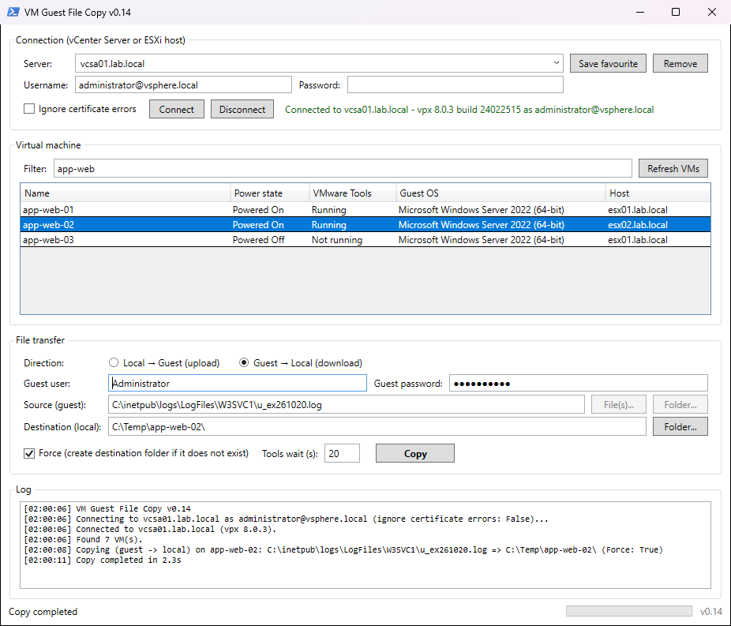

# VM Guest File Copy

**Version 0.14**

A small GUI over PowerCLI's `Copy-VMGuestFile` for copying files to and from a VM's guest OS through VMware Tools. It's a PowerShell script using WPF, so you don't need to install anything.



## Features

- Connect to a vCenter Server or a standalone ESXi host.
- Keep a favourites list of servers, each with its certificate setting. Usernames and passwords are never saved.
- An **Ignore certificate errors** checkbox for self-signed certificates.
- A VM list you can filter, showing power state, VMware Tools status, guest OS and host.
- Copy **Local → Guest** or **Guest → Local**. You can pick several local files or a whole folder.
- **Force** creates the destination folder if it doesn't exist.
- The window stays responsive during long copies because PowerCLI runs in a background runspace.

## Folder layout

```
VMGuestFileCopy.ps1        <- the GUI
Modules\                   <- optional portable PowerCLI (not in the repo, see below)
```

## Starting the tool

Either of these works:

- From a PowerShell prompt in the tool's folder, run `.\VMGuestFileCopy.ps1`.
- Right-click `VMGuestFileCopy.ps1` and choose **Run with PowerShell**.

If Windows refuses to run the script because it was downloaded from the internet, unblock it once. Right-click the file, choose **Properties**, and tick **Unblock**. Or run `Get-ChildItem -Recurse | Unblock-File` in the folder.

## Requirements on the server

| Requirement | Notes |
|---|---|
| Windows PowerShell 5.1 + WPF | Built into Windows Server 2016 and later |
| .NET Framework 4.7.2+ | Built into Server 2019/2022/2025. **Server 2016 ships with 4.6.2**, which current PowerCLI can't use |
| PowerCLI (`VMware.VimAutomation.Core`) | Either installed normally, or copied into a `.\Modules` folder next to the script (see below) |
| Network | TCP 443 to vCenter **and to the ESXi hosts**. The file data goes straight to the host running the VM, not through vCenter |
| Guest | VMware Tools running, plus a guest OS account |

## Getting PowerCLI

The script looks for PowerCLI in a `Modules` folder next to it first, then in the normal PowerShell module locations.

- **If PowerCLI is already installed on the server,** there's nothing to do.
- **To use it without installing,** save a copy into `Modules` on any machine with internet access, then copy the folder to the server(s):

  ```powershell
  Save-Module -Name VMware.VimAutomation.Core -Path .\Modules
  ```

  This saves only `VMware.VimAutomation.Core` and the modules it depends on.
- **With no PowerShell Gallery access,** download the PowerCLI offline ZIP from the Broadcom developer portal. Extract `VMware.VimAutomation.Core` and the modules it depends on (`VMware.VimAutomation.Common`, `VMware.VimAutomation.Sdk`, `VMware.Vim`, `VMware.VimAutomation.Cis.Core`) into `Modules\`.

## Usage notes

- Favourites are stored in `%APPDATA%\VMGuestFileCopy\favourites.json`. Each Windows user has their own list.
- End guest destination folders with a separator, for example `C:\Temp\` or `/tmp/`. Otherwise the last part of the path is treated as a file name.
- Guest paths are typed by hand. Copy-VMGuestFile can't browse the guest file system.
- To copy several files at once, separate the source paths with `;`.

## Versioning

The version is recorded in two places at the top of `VMGuestFileCopy.ps1`:

- the **`.NOTES`** section of the header comment
- **`$script:AppVersion`**, which is what the window shows in its title, in the bottom-right corner and as the first line of the log

| Version | Changes |
|---|---|
| 0.14 | Removed `Get-PowerCLIPortable.ps1`. The README now explains how to install PowerCLI or put a copy in `Modules`. |
| 0.13 | Removed the `.cmd` launcher and the window icon. The tool is now just the PowerShell script. |
| 0.12 | The vCenter/ESXi password field is cleared as soon as the connection succeeds. If the connection fails, the password is kept so you can retry. |
| 0.11 | The selected VM stays highlighted when you click into another field. It also stays selected when you change the filter or refresh the VM list, as long as it's still in the list. |
| 0.1 | First versioned release. Copies files to and from guests and keeps a favourites list (server and certificate setting only). |

<sub>Developed with AI assistance</sub>
